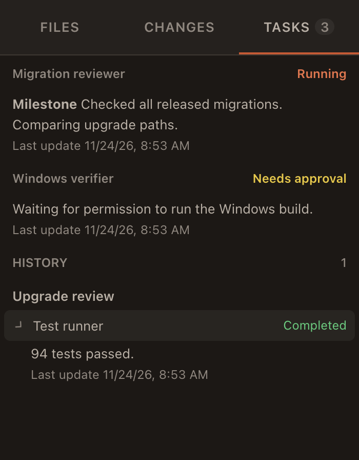

Agents often rewrite their task list as work shifts. Claudette keeps the latest checklist visible while preserving earlier runs in the workspace's **Tasks** tab.

## Current Tasks

Open the right sidebar and choose **Tasks**. The **Current** section shows the selected chat session's active task list, including status updates from Claude's task and todo tools and Codex's `update_plan` snapshots. When Codex includes a plan explanation, Claudette shows it above the checklist.

The tab badge counts every task the panel would surface — the active checklist plus any subagent buckets plus every task across archived history runs — so a workspace with older task lists still signals that there is task context to review.

## Following the Active Task

As an agent works through a long checklist, Claudette keeps the **currently-active task** scrolled into view — the task that is `in_progress`, or the next `pending` one if none is in progress. When the agent moves on, the list follows the new active task with a smooth scroll so you never have to chase active work down a long list.

Auto-follow yields the moment you scroll the list yourself — wheel, trackpad, scrollbar, or keyboard. The list then stays exactly where you put it even as new task transitions arrive, so you can read **History** without being pulled away. A **Jump to current** pill appears at the bottom of the list whenever the active task is off-screen; click it to scroll back to the active task and re-enable auto-follow.

Like every other scroll surface in Claudette, the Tasks list does not elastic-bounce at its top and bottom edges.

## Subagent Tasks

A delegated agent appears in **Tasks** even when its assignment needs no checklist. Open the agent summary in chat to see the workers, their latest status, and any results or milestones they reported. A child can continue running after the parent answers. The stored status is the last observation Claudette received.

- **Claude Code** supplies agent lifecycle events and can show nested tool activity and checklists.
- **Codex** identifies each worker by its thread. Spawning or waiting on several workers can update each one independently.
- **Antigravity** can expose a delegation without a child conversation ID. In that case Claudette shows **Delegated**. The launch call returning only confirms the handoff.

An agent can report a milestone, a blocker, or a result through Claudette. A reported result and the provider's completion state appear separately. Reopening the chat or reconnecting to a shared desktop reloads the saved run details. A standalone server records the Claude lifecycle events it receives. Claudette’s MCP reporting tool and the Codex and Antigravity harnesses are available on desktop hosts.

When Codex workers ask questions or request approval, each request has its own card in the parent chat. You can answer them in any order, including after the parent turn ends.

## Sibling Sessions

TeamCreate teammates run as **sibling chat sessions** in the same workspace. Expand a worker in **Tasks** and select **Open teammate tab** to visit its linked session when available. While a teammate's agent is still running, that session's live tasks (and its own subagents) appear as a dedicated lane in the Tasks panel — distinguished from **Current** by the session name and a pulsing live dot. Only after the teammate goes idle do its leftover tasks graduate into **History** under the session's name.

The right sidebar remembers which tab (**Files**, **Changes**, or **Tasks**) you last selected for each workspace. Switching to a different workspace and back leaves your tab choice intact — every workspace returns to exactly where you left it. On a brand-new workspace, the tab defaults to **Files**; it auto-switches to **Tasks** the first time live tasks appear so you don't have to hunt for the tab. Once you've explicitly chosen a tab for that workspace (or the auto-switch has fired), the choice is locked in for the session and no further auto-switches occur. Restarting the app resets all workspaces to **Files**.

## Historical Runs

When Claude replaces a checklist with a materially different one, Claudette moves the previous checklist into **History**. Codex plan updates are also full snapshots, but status-only updates to the same step list stay in **Current** so normal progress does not flood history; a materially different `update_plan` checklist archives the previous plan run. Runs are grouped by chat session and start collapsed so the current work stays easy to scan.

Each run header shows the run number and completion count. Expand a run to see the final saved checklist snapshot, including completed and pending items. Archived chat sessions are included and labeled so long-running workspace history stays available even after you clean up old tabs.

Task history is derived from the saved conversation and tool activity for the workspace. It survives app restarts, but clearing, deleting, or rolling back the underlying chat history also changes the derived task history.
